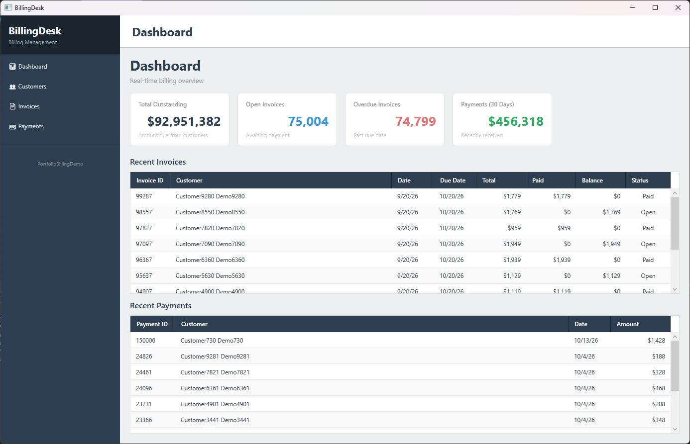
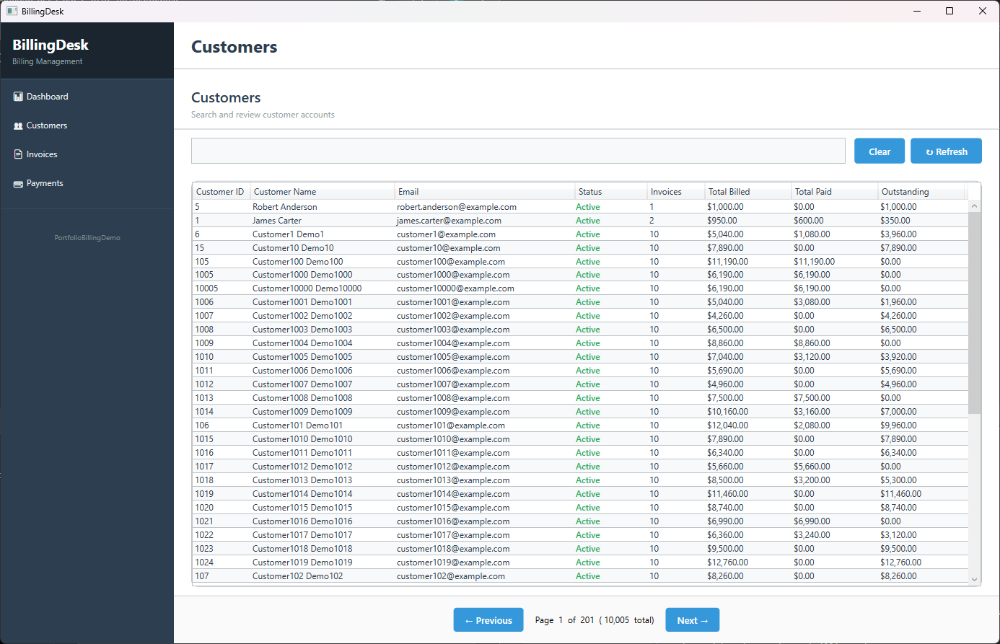
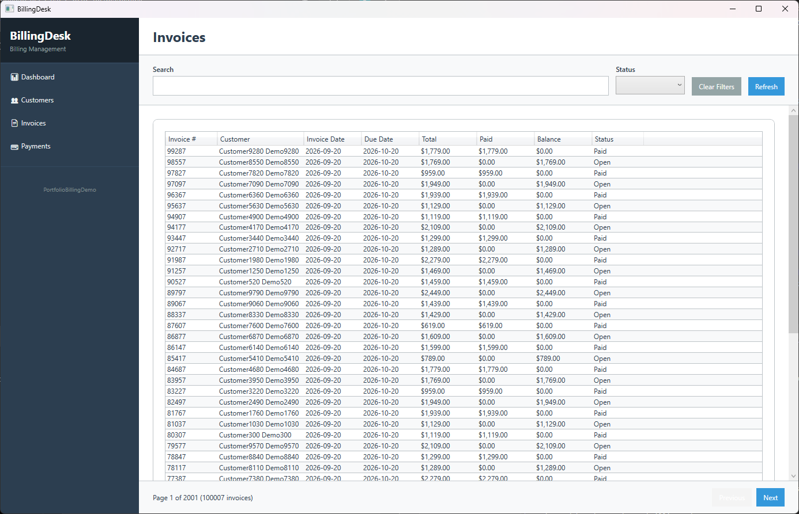
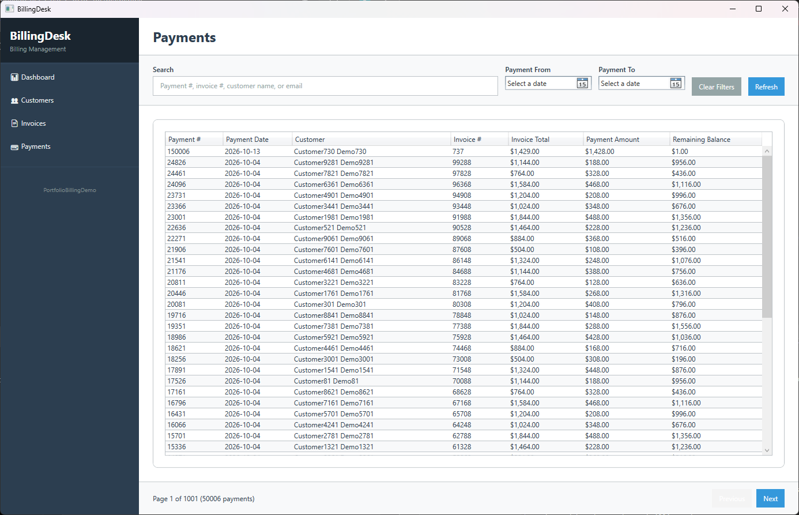

# BillingDesk

**A C#/.NET desktop billing management application built with WPF, Entity Framework Core, and Microsoft SQL Server.**

BillingDesk is a portfolio application demonstrating enterprise software development practices, financial business logic, relational database design, and transactional payment processing.

## Features

- **Dashboard:** Financial summaries, outstanding balances, overdue invoices, and recent activity.
- **Customer Management:** Searchable, paginated customer list with financial summaries and invoice history.
- **Invoice Management:** Invoice browsing, detailed line items, payment history, and balance calculations.
- **Payment Management:** Payment search, payment details, and navigation between related records.
- **Payment Entry:** Record partial or full payments with validation, database transactions, and concurrency protection.
- **Automated Testing:** Integration tests for financial calculations, payment validation, transaction rollback, and concurrent submissions.

## Technology Stack

| Component | Technology |
|---|---|
| Language | C# |
| Framework | .NET 10 |
| Desktop UI | WPF |
| Architecture | MVVM |
| MVVM Toolkit | CommunityToolkit.Mvvm |
| Database | Microsoft SQL Server |
| Data Access | Entity Framework Core |
| Dependency Injection | Microsoft.Extensions.Hosting |
| Testing | xUnit, SQL Server LocalDB |

## Technical Highlights

BillingDesk demonstrates enterprise-style application development with an emphasis on maintainable architecture, efficient database operations, and accurate financial processing.

- **MVVM Architecture:** Separates WPF views, presentation logic, business services, and data access using CommunityToolkit.Mvvm.
- **Entity Framework Core:** Uses `IDbContextFactory` and dependency injection to manage SQL Server database access.
- **Server-Side Pagination:** Retrieves customer, invoice, and payment records efficiently without loading entire datasets into memory.
- **Financial Calculations:** Calculates invoice totals, recorded payments, outstanding balances, and overdue invoices.
- **SQL Query Optimization:** Aggregates invoice items and payments separately to prevent incorrect totals caused by duplicated join results.
- **Transactional Payment Processing:** Validates payments and uses database transactions and concurrency protection to prevent overpayments.
- **Dependency Injection:** Uses the .NET Generic Host for service and ViewModel registration.
- **Automated Testing:** Includes 26 passing integration tests covering financial calculations, payment validation, rollback behavior, and concurrency.

### Large Dataset Testing

In addition to the included sample database, BillingDesk has been tested against a larger development dataset:

| Data | Records |
|---|---:|
| Customers | 10,005 |
| Invoices | 100,007 |
| Payments | 50,006 |

The larger dataset demonstrates SQL Server integration, pagination, financial reporting, and application navigation at scale.

**Note:** The public database seed script creates a smaller fictional dataset for demonstration purposes. The larger development dataset is not included in the repository.

## Architecture

BillingDesk separates responsibilities into:

- **Views:** WPF user interfaces and navigation.
- **ViewModels:** Presentation state, commands, and user interaction.
- **Services:** Database queries, financial calculations, and payment operations.
- **Data:** Entity Framework Core database context and entity configurations.
- **Models:** Customers, invoices, invoice items, and payments.
- **Tests:** Integration tests using isolated SQL Server LocalDB databases.

## Financial Business Rules

Invoice totals are calculated from their line items rather than stored as redundant values.

**Invoice Total = Sum of (Quantity × Unit Price)**

**Amount Paid = Sum of recorded payments**

**Outstanding Balance = Maximum of (Invoice Total − Amount Paid, 0)**

Outstanding balances are calculated per invoice before aggregation, preventing an overpayment on one invoice from reducing the outstanding balance of another.

Payment entry validates amounts and dates, recalculates balances within a database transaction, and uses SQL Server locking to protect against concurrent overpayment attempts.

## Testing

The current automated test suite contains **26 passing tests** covering payment processing, concurrency, rollback behavior, financial aggregation, and edge cases such as zero-item and overpaid invoices.

Tests use isolated SQL Server LocalDB databases rather than the demonstration database.

## Project Status

Core application functionality is complete, including customer management, invoice tracking, payment processing, financial reporting, and automated integration testing.

## Local Setup

BillingDesk requires .NET 10 and Microsoft SQL Server LocalDB.

1. Clone the repository.
2. Open `BillingDesk.slnx` in Visual Studio.
3. Follow the database setup instructions in [Database/QUICKSTART.md](Database/QUICKSTART.md).
4. Verify the `BillingDb` connection string in `appsettings.json`.
5. Build and run the BillingDesk application.

Automated integration tests can be executed using Visual Studio Test Explorer.

## Purpose

This project was developed as a professional portfolio demonstration of C#/.NET application development, SQL Server integration, enterprise business logic, and software testing.

## Application Screenshots

### Dashboard

Financial overview showing outstanding balances,
open and overdue invoices, recent invoices,
and payment activity.

### Customer Management

Customer management with searchable records, SQL-side
pagination, account status, and financial summaries
including total billed, payments received, and
outstanding balances.

### Invoice Management

Invoice tracking with customer information, invoice and due dates, payment totals, outstanding balances, status filtering, and server-side pagination across a large SQL Server dataset.

### Payment Management

Payment tracking with invoice associations, customer information, date-range filtering, searchable records, remaining-balance calculations, and server-side pagination.